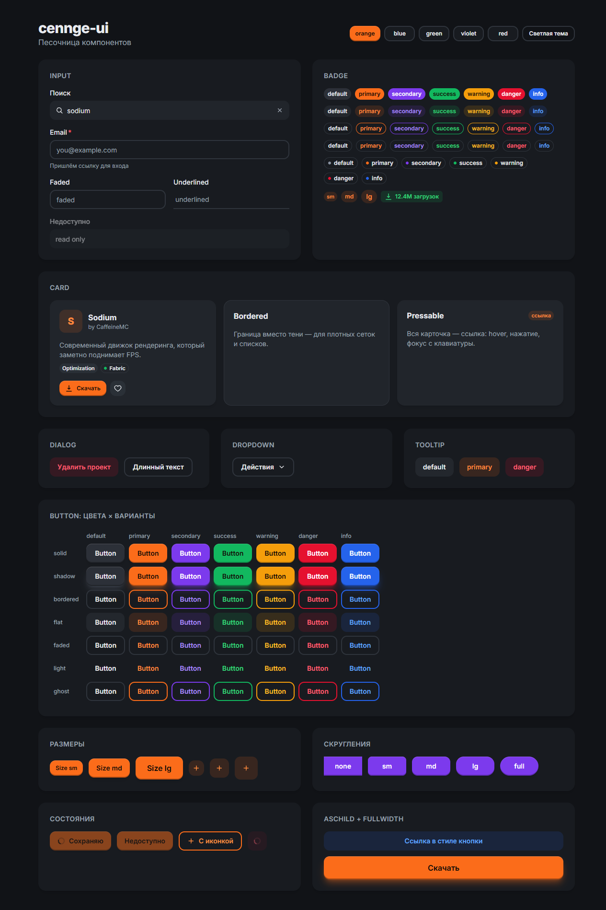
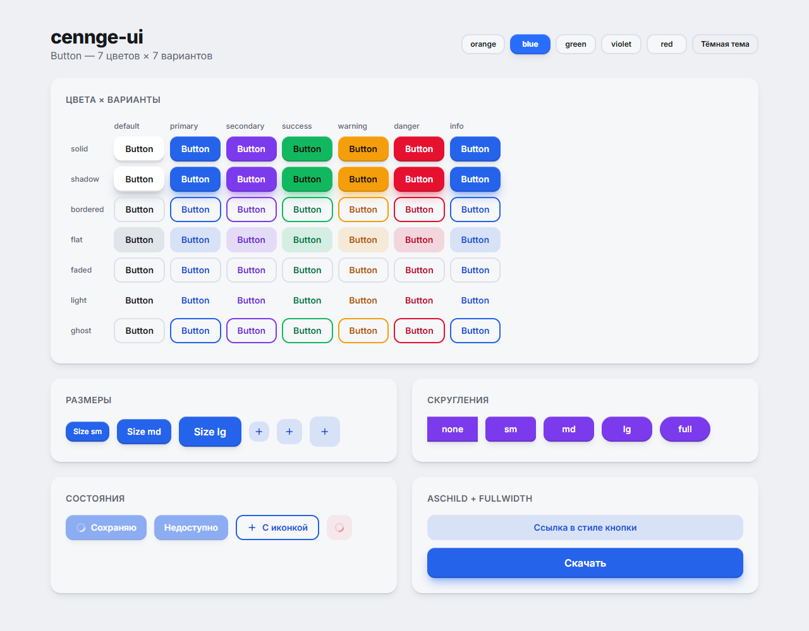

<div align="center">

# cennge-ui

**Tactile, dark-first React components on Radix UI and Tailwind CSS v4.**

A regular npm package — `npm update` and every app gets the fix.

[](https://github.com/Cennge/cennge-ui/actions/workflows/ci.yml)
[](https://www.npmjs.com/package/cennge-ui)
[](LICENSE)




</div>

## Why

- **Dark-first, tactile look.** Depth from layered surfaces, a raised edge on solid buttons, a soft press.
- **Recolour without a rebuild.** Every colour, radius and surface is a `--cennge-*` CSS variable.
  Switch the accent with one attribute: `data-accent="blue"`.
- **Updates instead of copy-paste.** Install once, fix bugs centrally.
- **Accessible by default.** Behaviour and focus management come from Radix primitives.
- **Light on dependencies.** No CSS-in-JS, no animation library: motion is plain CSS and respects `prefers-reduced-motion`.
- **Server Components ready.** `"use client"` ships in the build; helpers stay server-safe.

> **Status:** early development (0.x).
> **54 components.**
> Forms: Button · Input · PasswordInput · OtpInput · Textarea · NumberInput · DatePicker · DateRangePicker · TimeInput · Select · Combobox · MultiSelect · TagsInput · FileUpload · Checkbox · RadioGroup · Switch · Slider · Rating · ToggleGroup.
> Overlays: Dialog · AlertDialog · Command · Drawer · Popover · Dropdown · ContextMenu · HoverCard · Tooltip · Toast.
> Display: Table · Tree · Calendar · RangeCalendar · Card · Badge · Avatar · Indicator · Alert · Progress · CircularProgress · Skeleton · Spinner · EmptyState · Kbd · Snippet · Separator · Timeline.
> Navigation: Sidebar · Tabs · Accordion · Breadcrumbs · Pagination · Stepper.

<details>
<summary>Light theme with the blue accent preset</summary>
<br />

</details>

## Install

```bash
pnpm add cennge-ui
```

Peer dependencies: `react` and `react-dom` 17, 18 or 19; `tailwindcss` 4.

```css
/* app.css */
@import "tailwindcss";
@import "cennge-ui/styles.css";
```

That is the whole setup. The stylesheet registers the package with Tailwind (`@source`), adds the tokens,
and makes `dark:` class-based.

```tsx
import { Button } from "cennge-ui";

<Button color="primary" variant="shadow" size="lg">
  Download
</Button>;
```

## Theming

- **Dark mode:** `class="dark"` on `<html>`. Works with `next-themes` (`attribute="class"`).
- **Accent preset:** `data-accent="orange" | "blue" | "green" | "violet" | "red"` on `<html>` or any subtree.
- **Your own colours:** override the `--cennge-*` variables in your CSS, for example:

```css
:root {
  --cennge-primary-50: #eef6ff; /* …through… */
  --cennge-primary-950: #0b1f3a;
  --cennge-primary: #1f6feb;            /* solid fill */
  --cennge-primary-foreground: #ffffff; /* text on the fill */
  --cennge-primary-text: #1a5fd0;       /* the colour as text, light theme */
}
.dark {
  --cennge-primary-text: #6ea8ff;       /* the colour as text, dark theme */
}
```

Radii, surfaces, borders and motion are variables too (`--cennge-radius-medium`, `--cennge-surface-2`…).
See [`src/styles.css`](src/styles.css).

## Button

| prop | values | default |
| --- | --- | --- |
| `color` | `default` `primary` `secondary` `success` `warning` `danger` `info` | `default` |
| `variant` | `solid` `shadow` `bordered` `flat` `faded` `light` `ghost` | `solid` |
| `size` | `sm` `md` `lg` | `md` |
| `radius` | `none` `sm` `md` `lg` `full` | `md` |
| `isIconOnly`, `fullWidth`, `isDisabled`, `isLoading` | boolean | `false` |
| `startContent`, `endContent`, `spinner` | ReactNode | |
| `asChild` | render your own element, e.g. a router `<Link>` | `false` |
| `className` | merged with tailwind-merge, wins over variant classes | |

## Components

```tsx
import {
  Badge, Button, Card, CardBody, CardFooter, CardHeader,
  Dialog, DialogBody, DialogClose, DialogContent, DialogDescription, DialogFooter, DialogHeader, DialogTitle, DialogTrigger,
  Dropdown, DropdownContent, DropdownItem, DropdownSeparator, DropdownTrigger,
  Input, Tooltip,
} from "cennge-ui";

// Input — controlled or uncontrolled, with label, helper text, validation and a clear button
<Input label="Email" isRequired isClearable value={email} onValueChange={setEmail}
       isInvalid={!valid} errorMessage="Enter a valid email" />

// Badge — solid, flat, bordered, faded, dot
<Badge color="success" variant="dot">Online</Badge>

// Card — raised, bordered, flat; pressable as a link
<Card asChild isPressable>
  <a href="https://github.com/Cennge/ai-niche-scout">
    <CardHeader>ai-niche-scout</CardHeader>
    <CardBody>Validate an AI startup idea: competitors and 54 AI niches</CardBody>
  </a>
</Card>

// Tooltip — works with or without the provider
<Tooltip content="Star this repository" showArrow>
  <Button isIconOnly aria-label="Star"><StarIcon /></Button>
</Tooltip>

// Dialog — long content scrolls inside DialogBody
<Dialog>
  <DialogTrigger><Button color="danger">Delete</Button></DialogTrigger>
  <DialogContent size="sm">
    <DialogHeader>
      <DialogTitle>Delete project?</DialogTitle>
      <DialogDescription>This cannot be undone.</DialogDescription>
    </DialogHeader>
    <DialogFooter>
      <DialogClose><Button variant="flat">Cancel</Button></DialogClose>
      <Button color="danger" onClick={remove}>Delete</Button>
    </DialogFooter>
  </DialogContent>
</Dialog>

// Dropdown
<Dropdown>
  <DropdownTrigger><Button variant="faded">Actions</Button></DropdownTrigger>
  <DropdownContent>
    <DropdownItem shortcut="⌘E" onAction={edit}>Edit</DropdownItem>
    <DropdownSeparator />
    <DropdownItem color="danger" onAction={remove}>Delete</DropdownItem>
  </DropdownContent>
</Dropdown>
```

Inner parts of `Input` and `DialogContent` take classes through `classNames={{ slot: "…" }}`.

### Toasts

Mount `<Toaster />` once, then call `toast()` from anywhere — event handlers, data hooks, plain modules.

```tsx
import { Toaster, toast } from "cennge-ui";

<Toaster placement="bottom-right" />;

toast("Link copied");
toast.success("Deployed", { description: "v0.1.0 is live" });
toast.warning("Branch is behind", { action: { label: "Update", onClick: rebase } });
toast.promise(push(), { loading: "Pushing…", success: "Pushed", error: "Push failed" });
```

### Select, Combobox, MultiSelect

```tsx
import { Combobox, Select, SelectItem } from "cennge-ui";

// Select — a fixed list. `null` means "nothing selected"; isClearable returns to the placeholder.
<Select label="Language" value={lang} onValueChange={setLang} isClearable>
  <SelectItem value="ts">TypeScript</SelectItem>
  <SelectItem value="py">Python</SelectItem>
</Select>

// Combobox — type to filter. Full keyboard support: arrows, Home/End, Enter, Escape.
const repos = [
  { value: "cennge-ui", label: "cennge-ui", description: "React UI library" },
  { value: "ai-niche-scout", label: "ai-niche-scout" },
];
<Combobox label="Repository" items={repos} value={repo} onValueChange={setRepo} isClearable />

// MultiSelect — the same component with selectionMode="multiple": tags, Backspace removes the last one.
<Combobox selectionMode="multiple" label="Topics" items={topics} values={selected} onValuesChange={setSelected} />
```

### More inputs

```tsx
<Textarea label="Release notes" minRows={3} maxRows={8} />          // grows with the text

<RadioGroup label="Visibility" value={visibility} onValueChange={setVisibility}>
  <Radio value="public" description="Anyone on the internet">Public</Radio>
  <Radio value="private">Private</Radio>
</RadioGroup>

<Slider label="Stars" value={range} onValueChange={setRange} min={0} max={1000} />   // [from, to] → "Stars Minimum", "Stars Maximum"
<Slider label="Opacity" defaultValue={70} formatValue={(v) => `${v}%`} />
<Slider label="Coverage" marks={[0, 50, 100].map((v) => ({ value: v, label: `${v}%` }))} />  // a click on a label moves the thumb
<Slider label="Parallel jobs" min={1} max={16} marks={[1, 2, 4, 8, 16]} restrictToMarks />   // stops only on the marks

<Rating label="Rate this repo" value={stars} onValueChange={setStars} />   // 0 = no rating; a second click clears
<Rating label="Docs" allowHalf defaultValue={3.5} />                      // half stars
<Rating isReadOnly value={4.3} aria-label="Average rating" />             // read as "Average rating: 4.3 stars"
```

### Drawer, Popover, Accordion, Progress, Pagination

```tsx
<Drawer>
  <DrawerTrigger><Button>Settings</Button></DrawerTrigger>
  <DrawerContent placement="right" size="md">          {/* left | right | top | bottom */}
    <DrawerHeader><DrawerTitle>Repository settings</DrawerTitle></DrawerHeader>
    <DrawerBody>…</DrawerBody>
  </DrawerContent>
</Drawer>

<Popover>
  <PopoverTrigger><Button>Share</Button></PopoverTrigger>
  <PopoverContent showArrow>…</PopoverContent>
</Popover>

<Accordion variant="splitted" selectionMode="multiple">
  <AccordionItem value="install" title="How do I install it?">pnpm add cennge-ui</AccordionItem>
</Accordion>

<Progress label="Uploading" value={42} />    {/* no value → indeterminate */}
<Pagination total={24} page={page} onPageChange={setPage} />
```

### NumberInput, TagsInput, FileUpload

```tsx
// Locale-aware: "1 234,5 ₽" in, 1234.5 out. Arrows, PageUp/PageDown, Home/End; hold − / + to repeat.
<NumberInput label="Budget" locale="ru-RU" min={0} step={100}
             formatOptions={{ style: "currency", currency: "RUB" }} value={budget} onValueChange={setBudget} />

// Free-typed tags: Enter or comma adds, pasted lists are split, duplicates are refused.
<TagsInput label="Topics" value={topics} onValueChange={setTopics} maxTags={10}
           validate={(tag) => /^[a-z0-9-]+$/.test(tag)} />

// Drag and drop or browse; type, size and count checks with readable reasons; image previews.
<FileUpload label="Screenshots" accept={["image/*", ".pdf"]} maxSize={5 * 1024 * 1024} maxFiles={4}
            value={files} onValueChange={setFiles} onReject={(rejections) => …} />
```

Pass `locale` to `CenngeProvider` once to format numbers and file sizes for your language.

### AlertDialog, Snippet, PasswordInput, OtpInput

```tsx
// AlertDialog: a click outside does not close it, focus starts on Cancel. Return a promise from
// onAction to keep it open with a spinner: it closes on success and stays open for a retry on failure.
<AlertDialog>
  <AlertDialogTrigger><Button color="danger" variant="flat">Delete repository</Button></AlertDialogTrigger>
  <AlertDialogContent>
    <AlertDialogHeader>
      <AlertDialogTitle>Delete Cennge/ai-niche-scout?</AlertDialogTitle>
      <AlertDialogDescription>Issues, releases and the wiki go with it.</AlertDialogDescription>
    </AlertDialogHeader>
    <AlertDialogFooter>
      <AlertDialogCancel>Cancel</AlertDialogCancel>
      <AlertDialogAction color="danger" onAction={() => deleteRepository()}>Delete</AlertDialogAction>
    </AlertDialogFooter>
  </AlertDialogContent>
</AlertDialog>

// Snippet: a copy button; the "$" is never copied. A line break gives one row per command.
<Snippet>pnpm add cennge-ui</Snippet>
<Snippet variant="bordered">{"git clone https://github.com/Cennge/ai-niche-scout.git
cd ai-niche-scout"}</Snippet>

// PasswordInput: show/hide keeps the caret in place, a form submit hides it again, Caps Lock hint.
<PasswordInput label="New password" autoComplete="new-password" description="At least 12 characters" />

// OtpInput: SMS autofill and paste fill every slot, one Tab stop, arrows move between slots.
<OtpInput label="Verification code" groupSize={3} onComplete={verify} />
```

Snippet falls back to a selected textarea where the Clipboard API is missing, e.g. a dev server opened over plain http.

### Dates and times

```tsx
// Values are ISO strings with no time zone: "2026-10-19", "14:30". They survive JSON, FormData and
// server actions, and daylight-saving changes never shift a day.
<DatePicker label="Release" value={date} onValueChange={setDate} minValue="2026-01-01" />

// Typing is lenient: "19.10.2026", "19/10/26" and "19102026" all work in ru-RU. Text that is not a
// date stays in the field, with the reason under it.
<DateRangePicker label="Vacation" value={range} onValueChange={setRange}   // { start, end } | null
                 isDateUnavailable={(date) => holidays.has(date)} />        // a range cannot cross these

// Arrows change the part under the caret: hours, minutes by step, or AM/PM.
<TimeInput label="Call" step={15} minValue="09:00" maxValue="18:00" />

<Calendar value={date} onValueChange={setDate} />                  // month and year pickers jump to any year
<RangeCalendar visibleMonths={2} value={range} onValueChange={setRange} />
```

Names, the first day of the week and the order of a typed date come from `Intl` for the `locale`
(set it once on `CenngeProvider`); there is no date library to ship. Combine a DatePicker and a
TimeInput for a date and time: `` `${date}T${time}` ``.

### Table and Tree

```tsx
// Native table markup; sortable headers set aria-sort. Hooks for client-side sorting and selection.
const { sortedRows, getSortProps } = useTableSort(repos, { getValue: (repo, column) => repo[column] });
const selection = useTableSelection(sortedRows.map((repo) => repo.id));

<Table aria-label="Repositories" isHoverable isLoading={isFetching}>
  <TableHeader>
    <TableColumn><Checkbox aria-label="Select all" isSelected={selection.allSelected}
      isIndeterminate={selection.someSelected} onValueChange={selection.toggleAll} /></TableColumn>
    <TableColumn {...getSortProps("name")}>Name</TableColumn>
    <TableColumn {...getSortProps("stars")} align="end">Stars</TableColumn>
  </TableHeader>
  <TableBody emptyContent={<EmptyState title="No repositories" />}>
    {sortedRows.map((repo) => (
      <TableRow key={repo.id} isSelected={selection.isSelected(repo.id)}>…</TableRow>
    ))}
  </TableBody>
</Table>

// TanStack Table: TableColumn takes its sort state and handler as they are.
<TableColumn onSort={header.column.getToggleSortingHandler()} sortDirection={header.column.getIsSorted()}>

// Tree: the WAI-ARIA tree keyboard, type-ahead, and children fetched on first open.
<Tree aria-label="Files" items={files} onAction={(file) => open(file.id)}
      loadChildren={(folder) => fetchFolder(folder.id)} />
```

### Command palette and Sidebar

```tsx
// ⌘K / Ctrl+K from anywhere. Focus stays in the search; every typed word must match the text or
// keywords, ignoring case and accents. Escape clears the query first, then closes.
<CommandDialog label="Commands">
  <CommandGroup heading="Repositories">
    <CommandItem onAction={() => router.push("/cennge-ui")} keywords={["ui", "components"]}>cennge-ui</CommandItem>
  </CommandGroup>
  <CommandSeparator />
  <CommandGroup heading="Actions">
    <CommandItem onAction={createRepository} shortcut={<Kbd keys="command">N</Kbd>}>New repository</CommandItem>
  </CommandGroup>
</CommandDialog>

// App shell: a column that collapses to icons on desktop, a drawer on phones that closes once a
// page is chosen, also with Next.js Link.
<SidebarLayout>
  <Sidebar label="Repository">
    <SidebarHeader>cennge-ui</SidebarHeader>
    <SidebarNav>
      <SidebarItem asChild isActive={pathname === "/issues"} icon={<IssueIcon />} endContent="12">
        <Link href="/issues">Issues</Link>
      </SidebarItem>
    </SidebarNav>
  </Sidebar>
  <main><SidebarTrigger /> …</main>
</SidebarLayout>
```

### Stepper and Timeline

```tsx
<Stepper activeStep={step} onStepClick={setStep} completedContent={<p>Done</p>}>
  <Step title="Repository" description="Owner and name"><RepoForm /></Step>
  <Step title="Settings"><SettingsForm /></Step>
  <Step title="Review" />
</Stepper>

<Timeline activeIndex={1}>                     {/* omit activeIndex for a plain history */}
  <TimelineItem title="Ordered" time="Mon" />
  <TimelineItem title="Shipped" time="Tue, 14:30" dateTime="2026-10-20T14:30" />
  <TimelineItem title="Delivered" />
</Timeline>
```

### Small building blocks

```tsx
<Kbd keys="command">K</Kbd>                                   {/* ⌘K, read as "Command K" */}
<Separator>or</Separator>

<Breadcrumbs maxItems={3}>                                    {/* middle collapses into "…" */}
  <BreadcrumbItem href="/Cennge">Cennge</BreadcrumbItem>
  <BreadcrumbItem href="/Cennge/cennge-ui">cennge-ui</BreadcrumbItem>
  <BreadcrumbItem>README.md</BreadcrumbItem>                   {/* last = current page */}
</Breadcrumbs>

<ToggleGroup aria-label="View" defaultValue="code">          {/* never ends up empty */}
  <ToggleGroupItem value="code">Code</ToggleGroupItem>
  <ToggleGroupItem value="preview">Preview</ToggleGroupItem>
</ToggleGroup>

<Indicator content={unread} label={`${unread} unread`} isInvisible={unread === 0}>
  <Button isIconOnly aria-label="Notifications"><BellIcon /></Button>
</Indicator>

<CircularProgress label="Test coverage" value={87} showValue />
<EmptyState title="No open issues" actions={<Button>New issue</Button>} />
```

`ContextMenu` and `HoverCard` follow the same pattern as `Dropdown` and `Popover`: a trigger plus content.

### Forms and feedback

```tsx
<Switch isSelected={on} onValueChange={setOn}>Pull request notifications</Switch>
<Checkbox isIndeterminate={some && !all} isSelected={all} onValueChange={selectAll}>All labels</Checkbox>
<Alert color="danger" title="Build failed" description="Typecheck job exited with code 2" isClosable />

<Tabs defaultValue="code" variant="underlined" color="primary">
  <TabsList aria-label="Repository">
    <TabsTrigger value="code">Code</TabsTrigger>
    <TabsTrigger value="issues">Issues</TabsTrigger>
  </TabsList>
  <TabsContent value="code">…</TabsContent>
  <TabsContent value="issues">…</TabsContent>
</Tabs>

<AvatarGroup max={3}>
  <Avatar src="https://github.com/Cennge.png" name="Cennge" isBordered />
  <Avatar name="Ann Lee" color="primary" isBordered />
</AvatarGroup>

<Skeleton isLoaded={!isLoading} className="h-4 w-40"><p>{user.name}</p></Skeleton>
```

## Provider (optional)

```tsx
import { CenngeProvider } from "cennge-ui";

<CenngeProvider color="primary" radius="lg" reducedMotion="user">
  {children}
</CenngeProvider>;
```

## Server Components

Components are client components (`"use client"` is in the build). Helpers that must run on the
server import from `cennge-ui/utils`:

```ts
import { cn, tv } from "cennge-ui/utils";
```

## Development

```bash
pnpm install
pnpm dev            # playground at http://localhost:5173
pnpm test           # Vitest unit tests
pnpm test:e2e       # Playwright: Chromium, Firefox, WebKit; desktop, Pixel and iPhone profiles
pnpm typecheck
pnpm build          # tsup → dist/
pnpm check:package  # publint + are-the-types-wrong
pnpm changeset      # describe a change for the next release
```

### How components are tested

- **Unit tests (Vitest + Testing Library)** for logic, roles and labels.
- **End-to-end tests (Playwright)** on isolated fixture pages (`playground/fixtures/*`, opened as
  `/fixture.html?name=…`) in all three engines — Chromium, Firefox and WebKit (Safari's engine) — with
  desktop, Pixel 7 and iPhone 17 profiles: real keyboard, mouse, touch, file choosers and drag events.
- **Accessibility:** every fixture runs through axe-core against WCAG 2.2 AA in the dark and the light theme,
  and so does the whole playground.
- **Clean console:** any error or warning in the browser console fails the test.

Contributions are welcome — see [CONTRIBUTING.md](CONTRIBUTING.md).

## License

[MIT](LICENSE) © Cennge
